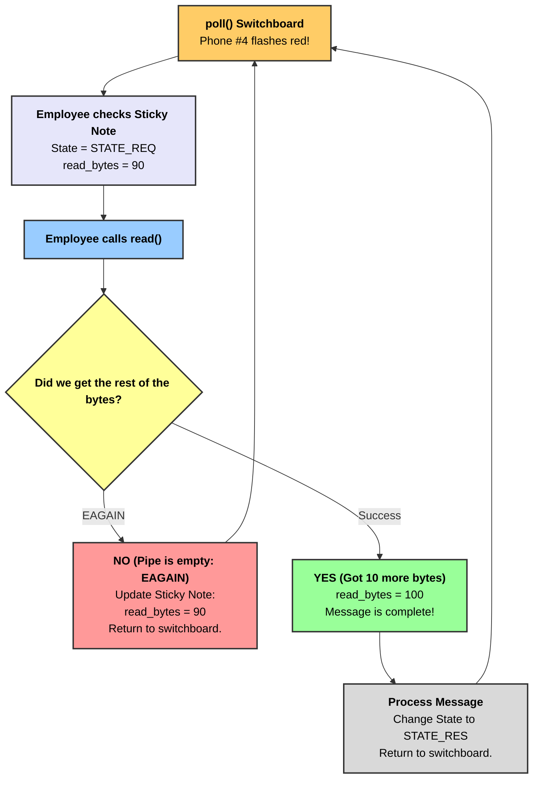

# Chapter 6: Non-Blocking I/O & The State Machine

## The Prologue: The Paralyzed Employee

**Why did we start?** In Chapter 5, we solved the "TCP Water Hose" problem by inventing a Protocol with a Length Header and a `read_full` function.
**Why do we need this chapter?** Our `read_full` function has a deadly flaw: it uses a `while` loop that *blocks* the thread until all the water is collected.
If a malicious hacker connects, promises 10,000 bytes, sends only 90 bytes, and then goes to sleep, our single employee will freeze holding the bucket forever. The entire server goes offline.

**How do we fix it?** We need to upgrade our phones so they never freeze, and we need to give our employee a pad of sticky notes.

---

## Character 11: Non-Blocking Phones (`O_NONBLOCK`)

By default, all File Descriptors (Phones) in Linux and Mac are **Blocking**. If you call `read()` and the pipe is empty, the operating system literally pauses your entire program and forces you to wait until water arrives.

We can fix this by telling the Operating System: *"Please make this phone Non-Blocking."*
When a phone is Non-Blocking, `read()` will scoop whatever water is there. If the pipe is completely empty, `read()` will NOT pause the program. Instead, it instantly returns an error code called `EAGAIN` (which basically means: *"I am empty right now, try again later!"*).

This perfectly saves our employee from freezing! They can put the bucket down and return to the switchboard.

---

## Character 12: The Sticky Note (`struct Conn`)

If our employee puts the bucket down to go help someone else, how will they remember what they were doing when they come back to this phone 10 minutes later?

They need a sticky note! In C++, we will create a `struct Conn` (Connection) for every single client on the switchboard.

```cpp
struct Conn {
    int fd = -1;             // Which phone is this?
    uint32_t state = 0;      // What was I doing? (Reading? Writing?)
  
    // The bucket for scooping water
    size_t read_bytes = 0;   // How many drops have I scooped so far?
    uint8_t read_buf[4096];  // The actual bucket holding the water
};
```

Whenever the employee gets the `EAGAIN` error, they quickly write down: *"I have scooped exactly 90 bytes into this bucket so far,"* stick the note to the phone, and spin back to the switchboard.

---

## Character 13: The State Machine

Because the employee is constantly jumping between 10,000 different phones, they need a very strict set of rules to know what to do when they pick up a phone. This is called a **State Machine**.

Our employee will only ever be in one of three States for a customer:

1. `STATE_REQ` (State Request): The employee is currently trying to read data from the pipe.
2. `STATE_RES` (State Response): The employee has finished reading, processed the data, and is currently trying to push the response into the pipe.
3. `STATE_END` (State End): The conversation is over and the phone should be destroyed.

---

## 🗺️ The Story Diagram (Chapter 6)

Here is how our single employee juggles multiple slow customers without ever freezing:




---

## 🛡️ The 5 Critical Edge Cases of Non-Blocking I/O

When scooping data from a non-blocking socket, your code must handle 5 distinct scenarios:

```cpp
// 1. Scoop whatever water is available in the pipe right now
ssize_t byte_scooping = read(c.fd, 
                            &c.read_buff[c.read_byte], 
                            sizeof(c.read_buff) - c.read_byte);

// --- EDGE CASE 1: Pipe is temporarily empty (EAGAIN / EWOULDBLOCK) ---
// On non-blocking sockets, EAGAIN means 0 bytes ready right now.
// NOT an error! Put the phone down, return to poll(), and wait for more.
if (byte_scooping < 0 && (errno == EAGAIN || errno == EWOULDBLOCK)) {
    continue; 
}

// --- EDGE CASE 2: Client disconnected (0) or real network error (< 0) ---
// 0 means client hung up (called close()). Remove them from switchboard.
if (byte_scooping <= 0) {
    close(c.fd);
    board.erase(board.begin() + i);
    connections.erase(connections.begin() + i);
    i--; // Keep vector indices aligned
    continue;
}

// Add scooped bytes to the bucket count
c.read_byte += (size_t)byte_scooping;

// --- EDGE CASE 3: Do we have at least 4 bytes for the header? ---
if (c.read_byte < 4) {
    continue; // Not enough bytes yet to know message length! Wait for next tick.
}

// Read promised length from first 4 bytes of bucket
uint32_t message_length = 0;
memcpy(&message_length, c.read_buff, 4);

// --- EDGE CASE 4: Message too large (Prevent memory exhaustion attack) ---
if (message_length > 4096) {
    close(c.fd);
    board.erase(board.begin() + i);
    connections.erase(connections.begin() + i);
    i--;
    continue;
}

// --- EDGE CASE 5: Do we have the FULL message yet? ---
// Total needed = 4 bytes (header) + message_length (payload)
if (c.read_byte < 4 + message_length) {
    continue; // Partial message! Wait for remainder in next poll tick.
}

// Full message is ready! Process and respond.
```

---

## 🧠 Deep-Dive Q&A & Systems Mechanics

### Q1: What does `activity` return from `poll()`?
`poll(board.data(), board.size(), -1)` returns:
- `activity > 0`: The **exact number of sockets ready for I/O** right now.
- `activity == 0`: Timeout expired (when a timeout is used).
- `activity < 0`: Syscall interrupted or failed (`-1`).

---

### Q2: What are `revents`, `POLLIN`, and the `&` operator?
- **`events`**: What WE ask the OS to watch (e.g. `POLLIN`).
- **`revents`** (Returned Events): What the OS kernel tells us actually happened.
- **The Bitwise `&` operator**: Sockets can have multiple events at once (e.g. `POLLIN | POLLHUP`). 
  - Using `board[i].revents & POLLIN` acts like a filter/mask: it tests **only** whether the `POLLIN` bit is set (1), ignoring other bits.
  - Using `==` would fail if multiple flags were set simultaneously.

---

### Q3: What is the difference between `EAGAIN` and `read() == 0`?
- **`read() == -1` with `errno == EAGAIN`**: 
  The pipe is **temporarily empty**. The client is still connected and alive! You simply `continue;` and wait for `poll()` to wake you up when more bytes arrive.
- **`read() == 0`**: 
  **EOF (End of File)**. The client closed their socket or crashed. The phone call is permanently over. Hang up (`close(c.fd)`) and erase from `board` and `connections`.

---

### Q4: Why does `conn& c = connections[i]` require the `&`?
- **Without `&` (`conn c = connections[i];`)**: C++ creates a **copy** in temporary memory. When you do `c.read_byte += 5;`, you only modified the copy! `connections[i].read_byte` remains 0 (silent bug).
- **With `&` (`conn& c = connections[i];`)**: `c` is a **direct reference** (alias) to the actual object inside `connections[i]`. Changes directly persist.

---

### Q5: Why pass `&c.read_buff[c.read_byte]` and `sizeof(c.read_buff) - c.read_byte`?
- **`&c.read_buff[c.read_byte]`**: The memory address of the **first empty box** in our bucket. It ensures the OS never overwrites bytes we already collected.
- **`sizeof(c.read_buff) - c.read_byte`**: The **remaining empty capacity**. If your buffer is 5000 bytes and you already scooped 4 bytes, only 4996 bytes can be accepted. Passing full 5000 without subtracting would cause a **Buffer Overflow / Segmentation Fault**.

---

### Q6: What if the client lies about the length?
- **Case 1: Promised Length > Actual Bytes (e.g. says 16, sends 5)**:
  `c.read_byte (9) < 4 + 16 (20)` remains true. The server will not crash, but this client hangs waiting forever. Production servers use **inactivity timeouts** to disconnect ghosting clients (Slowloris defense).
- **Case 2: Promised Length < Actual Bytes (e.g. says 3, sends 5)**:
  Server processes the first 3 bytes. Leftover bytes remain in the socket stream. Production servers use `memmove` (buffer shifting) to preserve remaining bytes for pipelined requests and reject invalid commands.
